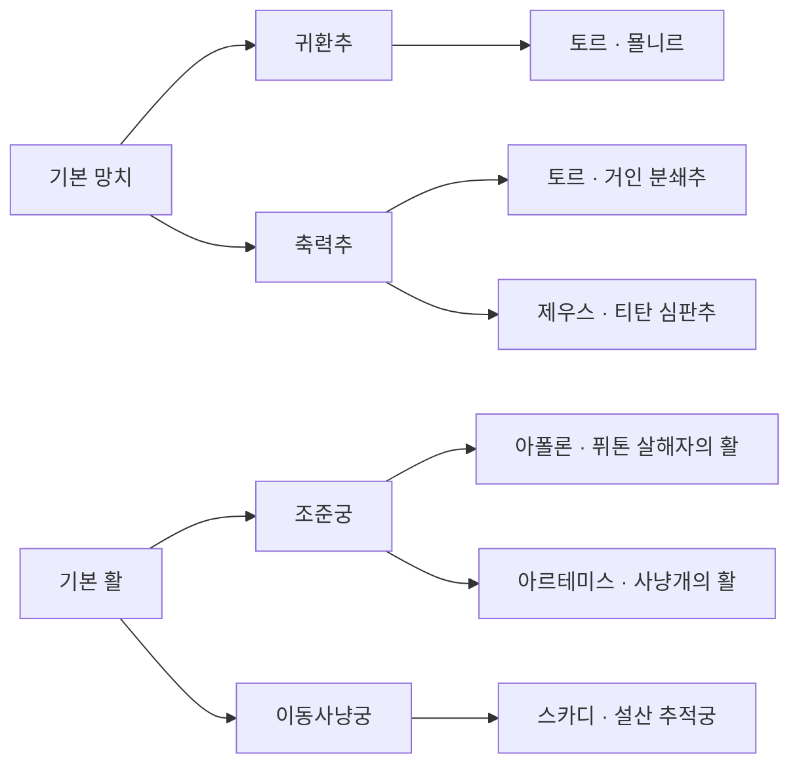

# 신성 테마와 무기 성장 계보

## 신화 빌드 Excel 작성 — 2026-10-12

build-0.3의 35개 무기 계보를 작성용 Excel로 옮겼다. 데이터 파일과 수치 상태는 [[05 검증과 확장/신화 빌드 Excel 데이터 계약]]을 따른다. 콘텐츠 후보의 채택 상태와 BUILD-V01–V11 실행 상태는 변경하지 않는다.

## 1. 현재 설계와 사용자 결정

**신격의 특징·설화 → 신별 큰 빌드 → 대표 3차 무기 → 공통 기능의 2차 → 기본 조작의 1차** 순서로 재작성했다. 플레이 성장 순서는 1차 → 2차 → 3차다. build-0.1의 속성 가칭·28종 균등 배치와 build-0.2의 재작성 예고를 본문에서 교체했다.

이번 구성은 **7신, 3차 18종, 2차 10종, 1차 7종**이다. 신별 배치는 제우스 3·토르 2·아폴론 3·아레스 3·하데스 2·아르테미스 3·스카디 2다. 수량은 이 설계의 결과이며 출시 제작량을 고정하지 않는다.

- 사용자 직접 결정: 실제 신화와 설화를 기반으로 작성한다. 대중 판타지에서 흔히 사용하는 신격을 허용하고 현재 널리 이어지는 종교의 신격은 제외한다. 힌두교 신격은 사용하지 않는다. 상세 선정 기준은 [[01 방향성/게임 방향성과 콘텐츠 원칙#신화 콘텐츠 선정 기준 — 2026-10-11]].
- 설계 위임에 따른 이번 작성: 아래 7신의 역할, 18종의 이름·효과, 2차 부모 관계, 카드와 연출 방향. 개별 콘텐츠의 사용자 채택·밸런스 검증까지 완료했다는 뜻은 아니다.
- 전승과 각색: 묠니르는 전승 속 고유 무기를 사용한다. 그 밖의 무기명은 이 게임의 창작명이다. 낙뢰 표식·은폐 시간·냉기 영역·상처 결산 등 전투 규칙은 게임적 각색이다.

### 세계관과 제작의 의미

검은 탑은 오리지널 이세계 침략신의 차원 고정 장치다. 지구 신화의 신들은 모루 조각에 공명하는 생존자의 무기를 통해 힘을 전한다. 1차는 인간의 무기, 2차는 신화 장인이 권능을 담을 수 있게 가공한 기능 양식, 3차는 설화의 힘을 받아들일 수 있는 완성된 무기다.

전승 무기의 이름도 탑 안에서 원본을 영구 소유한다는 뜻이 아니다. **묠니르의 형상과 권능을 일시적으로 재현한 무기**로 설명한다. 장인의 제작 양식과 신성의 공명 효과를 구분하며, 런 종료·발견·해금은 기존 R04를 따른다. [[04 마을과 성장/런과 훈련장 보강 기준]] · [[03 빌드와 무기/덱과 성장 보강 기준]].

## 2. 신별 설화와 큰 빌드

| 신격 | 전승 근거 | 큰 테마와 전투 순환 | 강점과 대가 | 설화에서 게임으로 옮긴 부분 |
| --- | --- | --- | --- | --- |
| 제우스 · 그리스 | 하늘·벼락·왕권, 키클롭스에게 받은 벼락으로 티탄과 싸움 [S1] | **선고와 집행**: 유효 타격으로 표식 → 정해진 마무리 공격 → 표적 낙뢰 | 여러 적에게 준비 가능 / 집행 전 표식 만료·대상 이탈 | 벼락과 통치의 모티프를 표식형 심판으로 각색 |
| 토르 · 북유럽 | 묠니르의 강타·투척 후 귀환, 거인들과의 싸움 [S2] | **무게와 귀환**: 공격을 확실히 맞힘 → 무거운 강타 또는 투척 → 회수·후속 타격 | 무거운 단발과 왕복 경로 / 투척 중 공격 공백·위치 부담 | 귀환은 전승 모티프, 충전·재사용·피해 판정은 게임 규칙 |
| 아폴론 · 그리스 | 궁술·예언·음악, 델포이의 퓌톤 처치 [S3] | **예고와 정확한 응답**: 조준/타격으로 다음 기회 표시 → 정밀 적중 또는 박자 준수 → 보상 | 우선 표적·정확한 타격 / 거리·각도·시점 실패 | 미래를 실제 계산하는 능력이 아닌 읽을 수 있는 공격 기회로 각색 |
| 아레스 · 그리스 | 격렬한 전쟁, 포보스·데이모스의 동행 [S4] | **압박과 붕괴**: 직접 공격으로 상처 → 접근 유지 → 결산·공포 | 근접 지속 압박 / 후퇴·빗나감으로 준비 손실 | 상처 스택과 공포 반경은 창작; 보스 면역 유지 |
| 하데스 · 그리스 | 지하세계의 지배, 보이지 않게 하는 투구 [S5] | **경계와 재등장**: 낙인 → 거리를 벌리거나 은폐 → 다시 닿아 회수 | 위험한 접근을 계획 / 무적 없이 짧은 재진입 기회 | 투구를 단검의 공명으로 번안; 영혼 수급을 무조건 처치 의존으로 두지 않음 |
| 아르테미스 · 그리스 | 활과 사냥개를 갖춘 야생의 사냥꾼 [S6] | **지정과 추렵**: 첫 직접 적중으로 사냥감 지정 → 따라붙거나 거리 재확보 → 집중 마무리 | 정예 표적 제거 / 대상 분산 시 이득 감소 | 사냥개 잔영은 추적 보조 공격; 자동 승리·벽 관통 없음 |
| 스카디 · 북유럽 | 바다보다 산을 택한 거처, 스키와 활을 통한 산악 사냥 [S7] | **이동과 사냥터**: 이동으로 유리한 거리 확보 → 발사/영역 형성 → 영역 밖으로 재배치 | 공간 확보·이동 사격 / 제자리 난사에는 공명 이득 적음 | 냉기·빙결은 산악 이미지의 각색이며 원전의 명시적 빙결 능력으로 주장하지 않음 |

아폴론은 태양 속성만으로 정의하지 않는다. 태양 자체의 빌드는 추후 헬리오스를 별도 검토할 수 있다. 하데스는 그리스 신화 신격이며 올림포스 12신과 동일 명단으로 취급하지 않는다. 스카디의 요툰 혈통과 신들의 세계와의 관계를 지우지 않는다.

### 비슷한 빌드를 구분하는 기준

- 제우스는 **누구에게 선고했는가**, 토르는 **언제 무거운 타격을 넣고 무기를 회수하는가**가 중심이다.
- 아폴론은 **다음 타격의 조건**, 아르테미스는 **사냥감의 유지**, 스카디는 **자신의 이동과 사냥터**가 중심이다.
- 아레스는 접근을 지속하고, 하데스는 짧게 이탈한 뒤 다시 들어온다. 둘의 상처·낙인은 별도 상태다.

## 3. 신별 3차 무기 상세

M3 키는 이 문서의 고유 설계 키다. 각 행의 기본 기능은 신성이 없어도 작동한다. 공명은 선택한 주 신성의 유지 조건과 해당 단계를 충족할 때만 켜진다. 3차 제작만으로 신성의 발견·각성·완성을 건너뛰지 않는다.

### 제우스 — 선고와 집행

| 키·3차 무기 / 부모 | 기본 기능 | 신성 공명과 소비 | 실패·보스 처리 | 설화·외형 |
| --- | --- | --- | --- | --- |
| M3-ZEU-SP **천벌의 창** / M2-SP-LINE | 창끝 직접 적중으로 표식, 연격 마지막 찌르기로 해당 표식 소비 | 소비한 대상 위치에 예고 후 낙뢰. 대상별 표식 하나를 한 번만 소비 | 낙뢰는 집행 시 고정된 지점을 공격하므로 이동 적은 회피 가능. 보스에도 표식·피해는 적용 | 벼락 모티프 [S1], 창작명. 갈라진 창끝·수직 섬광 |
| M3-ZEU-HM **티탄 심판추** / M2-HM-IMPACT | 일반 타격으로 충격 저장, 충전 내려찍기에 소비 | 첫 직접 강타 적중이 그 대상에게 선고를 남기고 후속 낙뢰 한 번 | 헛강타는 저장량 소비, 추가 낙뢰는 없음. 보스 경직 면역 유지 | 티탄 전쟁 [S1]의 창작 망치. 계단형 금속 머리 |
| M3-ZEU-SS **폭풍왕의 검과 방패** / M2-SS-COUNTER | 실제 전방 방어 후 다음 검 타격 강화 | 반격이 맞은 대상에 선고, 같은 실행의 끝에 낙뢰 한 번 | 방어 시간만으로 보상 없음. 후방·방어 불가 공격은 정상 위험 | 하늘의 왕권 [S1]의 창작 검방. 독수리 선형 장식 |

### 토르 — 무게와 귀환

| 키·3차 무기 / 부모 | 기본 기능 | 신성 공명과 소비 | 실패·보스 처리 | 설화·외형 |
| --- | --- | --- | --- | --- |
| M3-THO-HM-R **묠니르** / M2-HM-RETURN | 충전 특수행동을 망치 투척으로 전환, 최대 거리·장애물에서 회수. 왕복 별 실제 접촉 판정 | 유효 왕복 적중으로 귀환 보상 준비, 회수 후 다음 직접 근접 타격에 번개 충격 | 비행 중 일반·특수 재공격 불가. 귀환 완료 뒤 재개. 보스에도 왕복 별 상한 적용 | 전승 무기 [S2]. 짧은 자루·두꺼운 머리, 현대 작품 외형 복제 금지 |
| M3-THO-HM-I **거인 분쇄추** / M2-HM-IMPACT | 일반 타격의 저장 충격을 충전 내려찍기로 소비 | 유효 강타 중심에 짧은 충격파, 다음 준비를 위한 타격 리듬 유지 | 거인·대형 여부로 무조건 즉사시키지 않음. 헛강타 비용 반환 없음 | 거인과의 싸움 [S2]에서 만든 창작명. 균열 각인·굵은 충격 고리 |

### 아폴론 — 예고와 정확한 응답

| 키·3차 무기 / 부모 | 기본 기능 | 신성 공명과 소비 | 실패·보스 처리 | 설화·외형 |
| --- | --- | --- | --- | --- |
| M3-APO-SP **델포이의 예언창** / M2-SP-LINE | 창끝 적중 후 다음 찌르기의 정밀 거리 보상을 준비 | 다음 찌르기의 거리 구간을 표시, 그 구간에 실제 적중하면 좁은 관통광 | 예고는 자동 명중이 아님. 가까운 적은 기본 피해만, 보스도 거리 조건 동일 | 예언·델포이 [S3]의 창작 창. 월계·길게 뻗은 얇은 날 |
| M3-APO-BW **퓌톤 살해자의 활** / M2-BW-AIM | 같은 적의 직접 화살 적중으로 조준 보상 준비 | 준비된 다음 화살이 표적에 맞으면 뒤쪽 직선 관통. 발사 시 소비 | 빗나가면 보상 상실, 탄창·재장전 유지. 보스에게 관통 중복 적중 없음 | 퓌톤 처치·궁술 [S3], 창작명. 월계 문양·가느다란 현 |
| M3-APO-ST **칠현의 지팡이** / M2-ST-CADENCE | 마력탄 적중 후 표시되는 다음 발사 구간에 발사하면 기본 준비탄 강화 | 정해진 박자를 이어간 준비탄의 직접 적중에서 짧은 음파 추가 | 입력 유지도 발사 시점으로 판정. 박자 실패 시 연계만 초기화, 기본 사격 가능 | 음악·리라 [S3]의 창작 지팡이. 현 형태의 머리, 소리와 시각 예고 병행 |

### 아레스 — 압박과 붕괴

| 키·3차 무기 / 부모 | 기본 기능 | 신성 공명과 소비 | 실패·보스 처리 | 설화·외형 |
| --- | --- | --- | --- | --- |
| M3-ARE-SP **돌격대의 혈창** / M2-SP-PURSUIT | 같은 표적에 직접 찌르기를 이어 상처 축적 | 연격 마지막 찌르기가 상처 결산, 해당 적을 계속 압박할 다음 준비 부여 | 대상 변경·상처 만료에 손해. 이동 자체는 피해가 아니고 자동 돌진 없음 | 전장의 격렬함 [S4], 창작명. 전투 깃·붉은 홈 |
| M3-ARE-GS **포보스의 대검** / M2-GS-SEAL | 일반 베기로 표식, 기존 충전 회전으로 실제 닿은 대상의 표식 소비 | 결산한 대상 주변 일반 적에게 짧은 공포. 공포 재부여 제한 | 멀리 있는 표식은 소비하지 않음. 면역 보스는 결산 피해만, 공포 손실을 무제한 피해로 환급하지 않음 | 포보스의 동행 [S4], 창작명. 전면 가면형 가드 |
| M3-ARE-SS **데이모스의 검과 방패** / M2-SS-COUNTER | 유효 방어 후 직접 반격으로 상처 부여 | 같은 적에게 방어·반격을 이어가면 상처 결산과 근거리 위압 | 공격 없는 적에는 일반 검 연격 마무리로 느린 결산 가능. 방어 불가 공격을 무시하지 않음 | 데이모스 [S4], 창작명. 흠집 난 청동·뾰족한 방패 문양 |

### 하데스 — 경계와 재등장

| 키·3차 무기 / 부모 | 기본 기능 | 신성 공명과 소비 | 실패·보스 처리 | 설화·외형 |
| --- | --- | --- | --- | --- |
| M3-HAD-GS **저승문지기의 대검** / M2-GS-SEAL | 일반 베기의 낙인을 회전 베기로 회수하여 다음 직접 공격 강화 | 회수에 성공하면 한정 시간 명계의 경계 영역 생성. 영역 밖으로 나갔다 재진입한 다음 직접 타격 강화 | 처치 없이도 낙인 회수 가능. 영역 출입 반복으로 중첩 무한 생성 금지, 이동/공격 면역 없음 | 지하세계 경계 [S5]의 창작 대검. 문짝 같은 검신·봉인선 |
| M3-HAD-DG **보이지 않는 왕의 단검** / M2-DG-STALK | 지정 표적 직접 적중 후 이탈·재접근하면 후속 타격 강화 | 조건 충족 후 짧은 은폐 준비. 다음 일반 대시에 은폐를 소비하고 다음 공격 시작 시 해제 | 기존 대시 무적 시간을 연장하지 않음. 날아오는 탄·장판은 정상 판정. 은폐 종료 시 적 재탐색 | 보이지 않게 하는 투구 [S5]를 무기로 번안한 창작명. 먹빛 칼날·공명 시 윤곽 유지 |

### 아르테미스 — 지정과 추렵

| 키·3차 무기 / 부모 | 기본 기능 | 신성 공명과 소비 | 실패·보스 처리 | 설화·외형 |
| --- | --- | --- | --- | --- |
| M3-ART-SP **숲길 추렵창** / M2-SP-PURSUIT | 첫 적중으로 표적 지정, 거리를 다시 맞춘 창끝 타격 보상 | 정밀 재적중 뒤 표적까지 짧은 사냥개 잔영 돌진 | 잔영은 실제 이동·벽 충돌·도달 거리 제한. 표적 사망 시 다른 적 자동 지정 없음 | 사냥개 [S6]의 창작 창. 잎형 날·추적 매듭 |
| M3-ART-DG **사냥꾼의 쌍송곳니** / M2-DG-STALK | 표적에서 이탈 후 다른 각도로 접근해 직접 타격 보상 | 재접근 첫 적중이 사냥 마무리 준비, 다음 연격 마지막에 잔영 추가 타격 | 후방 판정 불가 보스에는 이탈 거리 조건으로 기본 보상 유지. 자동 순간이동 없음 | 사냥 모티프 [S6]의 창작 단검. 서로 다른 길이의 송곳니형 날 |
| M3-ART-BW **사냥개의 활** / M2-BW-AIM | 직접 화살로 지정한 적에 집중 사격 보상 | 지정 적 연속 적중으로 다음 사냥개 잔영 공격 준비 | 분산 사격 시 준비 손해. 잔영은 자동 효과이며 화살 적중·장탄 수급으로 재집계하지 않음 | 활과 사냥개 [S6], 창작명. 사냥 매듭·짧은 녹색 표식 |

### 스카디 — 이동과 사냥터

| 키·3차 무기 / 부모 | 기본 기능 | 신성 공명과 소비 | 실패·보스 처리 | 설화·외형 |
| --- | --- | --- | --- | --- |
| M3-SKA-BW **설산 추적궁** / M2-BW-MOVE | 유효 이동 거리를 확보한 뒤 다음 화살 강화. 발사 시 준비 소비 | 강화 화살 실제 적중점에 짧은 냉기 지대, 지대 밖 재배치 후 다음 강화탄이 내부 적에게 파쇄 피해 | 벽에 대고 이동 입력만 해서는 준비 안 됨. 둔화 면역 보스도 직접 파쇄 피해는 유지 | 산악 스키 사냥 [S7]의 창작 활. 길고 휜 활대·백색 흔적 |
| M3-SKA-ST **산바람의 지팡이** / M2-ST-CADENCE | 적중 후 다음 준비탄 발사 기회 표시 | 그 사이 실제 이동을 충족한 준비탄이 적중 지점에 얇은 냉기 띠 생성 | 영역 수·동일 대상 주기 상한. 제자리 박자 사격은 기본 기능만, 무한 빙결 없음 | 산악 거주·이동 [S7]을 마법 무기로 각색. 스키 끝 같은 머리·옅은 바닥 선 |

## 4. 3차를 묶은 2차 무기

2차의 테마는 ‘준비 행동과 소비 행동’으로 정의한다. 신성이 없어도 완결된 기능이어야 한다. 자식이 하나인 분기도 제작 가능하며 대장간 후보 수를 보장하는 표는 아니다.

| 키·2차 이름 | 공통 준비 → 소비와 독립 기능 | 연결되는 3차 키 | 부모 1차 |
| --- | --- | --- | --- |
| M2-SP-LINE **선고창** | 창끝·직선 적중 준비 → 다음 지정 찌르기 강화 | M3-ZEU-SP / M3-APO-SP | M1-SP |
| M2-SP-PURSUIT **추렵창** | 먼저 맞힌 표적 지정 → 같은 적 후속 찌르기 보상 | M3-ARE-SP / M3-ART-SP | M1-SP |
| M2-HM-RETURN **귀환추** | 충전 투척 → 실제 왕복 접촉 → 회수 후 근접 공격 재개 | M3-THO-HM-R | M1-HM |
| M2-HM-IMPACT **축력추** | 일반 적중 충격 저장 → 충전 내려찍기 소비 | M3-ZEU-HM / M3-THO-HM-I | M1-HM |
| M2-GS-SEAL **봉인대검** | 넓은 일반 베기로 표식 → 충전 회전으로 닿은 표식 결산 | M3-ARE-GS / M3-HAD-GS | M1-GS |
| M2-DG-STALK **잠행단검** | 지정 표적 직접 적중 → 거리 이탈 → 재접근 타격 강화 | M3-HAD-DG / M3-ART-DG | M1-DG |
| M2-SS-COUNTER **반격검방** | 유효 전방 방어 → 다음 직접 검 타격 강화 | M3-ZEU-SS / M3-ARE-SS | M1-SS |
| M2-BW-AIM **조준궁** | 같은 표적의 직접 화살 적중 → 다음 화살 강화 | M3-APO-BW / M3-ART-BW | M1-BW |
| M2-BW-MOVE **이동사냥궁** | 실제 이동으로 간격 확보 → 다음 화살 강화 | M3-SKA-BW | M1-BW |
| M2-ST-CADENCE **응답봉** | 기본탄 적중 후 발사 기회 표시 → 다음 준비탄 발사 보상 | M3-APO-ST / M3-SKA-ST | M1-ST |

선고창의 ‘선고’와 봉인대검의 ‘봉인’은 2차에서는 일반 기능 표식이다. 신성 태그를 스스로 생성하는 신성 효과가 아니다. 첫 장인의 선택은 양식을 정하고 위 기능은 해당 양식 안의 호환 분기로 제공한다. 장인별 지원 범위는 후속 데이터로 관리하되 특정 장인이 특정 신만 강제하지 않도록 한다.

## 5. 2차의 공통 조작을 배우는 1차

| 키·1차 | 기본 공격·역할 | 특수행동 | 2차에서 발전하는 조작 |
| --- | --- | --- | --- |
| M1-SP **기본 창** | 전방 직선 찌르기 연격·간격 유지 | 제안: charge_attack 계약의 집중 찌르기 | 선고창의 정밀 거리 / 추렵창의 표적 유지 |
| M1-HM **기본 망치** | 짧고 무거운 전방 타격 | 제안: charge_attack 계약의 충전 내려찍기 | 축력추의 준비 소비 / 귀환추의 같은 입력을 쓰는 투척 분기 |
| M1-GS **기본 대검** | 넓은 일반 베기 연격 | 기존: 충전 후 전방위 회전 베기 | 봉인대검의 표시·범위 내 결산 |
| M1-DG **기본 단검** | 짧고 빠른 연격 | 기존: 새 누르기로 패링 | 잠행단검의 거리·각도 재진입. 패링은 유지하되 빌드 필수 수급으로 강제하지 않음 |
| M1-SS **기본 검과 방패** | 전방 베기와 방어 전환 | 기존: 방향을 가진 유지 방어 | 반격검방의 실제 방어 후 검 타격 |
| M1-BW **기본 활** | 장탄을 쓰는 조준 화살 | 기존: 수동·빈 탄창 자동 재장전 | 조준궁의 표적 집중 / 이동사냥궁의 위치 변경 |
| M1-ST **기본 지팡이** | 제안: 장탄형 마력탄, 기본 발사 마나 무료 | 제안: 기존 reload 계약의 마력탄 재충전 | 응답봉의 적중 이후 발사 기회 읽기 |

무기 종류는 런 안에서 유지한다. 2차 귀환추는 망치의 기본 입력을 재사용하는 패턴 전환이지 새 단축키 추가가 아니다. 창·망치·지팡이 행동과 신규 효과는 기획 단계이며 구현된 것으로 취급하지 않는다. 석궁 등 이번 표 밖 무기를 삭제한다는 의미도 아니다.

## 6. 성장·선택·신성 조건

| 단계 | 기존 성장 계약과 대응 | 신성이 없는 경우 |
| --- | --- | --- |
| 1차 | 마을에서 무기 종류 선택 | 기본 공격·고유 특수행동 사용 |
| 2차 | 첫 대장간의 신화 양식과 호환 기능 분기 | 표식·투척·이동 준비 등 일반 기능 사용 |
| 3차 | 같은 종류·장인 양식 안의 기능 강화 | 3차 기본 기능 사용, 해당 신성 공명만 비활성 |

신성의 발견·각성·완성은 성소에서 별도로 진행한다. 전용 카드와 완성 공명 외형은 추가 제작 단계가 아니다. 카드·무기·장인 강화의 일반 태그로 자격을 만들고 신성 전용 효과는 자기 자격을 공급하지 않는다.

원하는 신성이 없어도 기본 기능으로 싸울 수 있다. 호환 후보를 얻지 못하면 기존 B04의 범용 기능 강화 경로를 사용한다. 한 자식만 있는 귀환추·이동사냥궁을 골랐다는 이유로 특정 신의 선택을 강제하지 않는다.

재단련은 같은 2차 부모 안의 3차 선택 변경으로 제안한다. 다른 무기 종류·장인 양식으로 건너뛰지 않는다. 자식이 하나면 형제 교체는 없고 범용 강화 계약을 따른다. 신성 교체 시점은 B05를 유지한다.

신성 조건 이탈·교체 시 공명 상태·영역·예약 낙뢰·사냥개·은폐를 제거한다. 기본 투척·기본 표식·기본 탄창은 유지한다. 복귀하면 공명만 재활성화하며 이전 스택은 되살리지 않는다.

## 7. 새로운 행동의 경계와 실패 처리

아래는 구현 요구사항이며 현재 코드의 지원을 의미하지 않는다. 기존 [[02 전투/전투 사건과 자원 및 방 전환 기준]]과 [[03 빌드와 무기/덱과 성장 보강 기준]]을 함께 따른다.

### 투척·귀환

- 귀환추/묠니르의 특수행동은 기존 charge_attack 예약·집행 시점에 마나를 소비하고 투척한다. 충전 중 취소는 기존 계약, 발사 후 빗나감은 환급하지 않는다.
- 비행 중 이동·기존 대시는 가능하지만 새 일반/특수 공격은 차단한다. 별도 회수 버튼은 없고 최대 거리·벽 접촉에서 자동 귀환한다.
- 벽 접촉 시 출발 경로를 역으로 회수한다. 장애물을 통과하는 피해 판정을 만들지 않는다. 회수 지연 상한 도달 시 공격 판정을 끄고 소유자에게 외형만 복귀시켜 영구 무장해제를 막는다.
- 한 실행의 전진·귀환에 각각 대상별 적중 상한을 둔다. 투척은 직접 특수공격 출처, 추가 번개는 자동 효과 출처다. 귀환 적중으로 귀환 효과를 재귀 생성하지 않는다.
- 기절 중에는 비행 판정을 중단하고 회수 상태로 전환한다. 사망·방 이동·재단련 시 투척을 종료하고 손의 무기 표시·공격 잠금을 함께 복구한다.

### 은폐·재진입

- 하데스의 은폐는 시각적 투명도와 적의 신규 조준 탐색을 제한하는 상태다. 충돌·피해 면역이 아니며 이미 발사된 탄·영역 공격은 유지한다.
- 낙인 표적과의 실제 거리 이탈 뒤 재접근을 평가한다. 입력만 누르거나 표적의 강제 이동만으로 소유자의 이동 보상을 만들지 않는다.
- 은폐 준비 후 다음 대시에서 소비하고 공격 시작·기한 만료·피격·신성 비활성화에 해제한다. 적이 은폐를 인식한 경우 마지막 확인 위치까지만 추적하며 종료 후 정상 재탐색한다. 보스의 예정 광역 공격은 취소하지 않는다.

### 리듬·이동 사격·표적

- 응답봉은 직접 적중 시 다음 유효 발사 구간을 표시한다. 실제 발사 시점으로 판정하며 입력 유지·연타에 같은 규칙을 적용한다. 연격/공속 변경 시 실행 시작 스냅샷으로 구간을 정하고 소급 변경하지 않는다.
- 이동 보상은 이동 가능한 공간에서 소유자의 실제 자발적 이동 거리를 사용한다. 벽 밀기·넉백·텔레포트·방 이동은 수급에서 제외한다. 대시 이동 포함 여부는 포함으로 제안하되 대시당 실제 거리만 한 번 계산한다.
- 사냥 표적은 소유자별 하나다. 무효화·사망 시 해제하고 다음 직접 적중으로 지정한다. 사냥개는 실제 이동·가림·최대 거리·수명 제한을 두고, 표적을 잃으면 소멸한다.

### 공통 효과·보스·상태 정리

- 표식·저장량은 기본/공명 출처를 분리하고 상한·만료·재수급 주기를 둔다. 유효 직접 피해만 수급한다. ‘다음 공격’은 실행 ID 하나에 소비되며 다중 대상 때문에 소비량을 복제하지 않는다.
- 낙뢰·공포·냉기·사냥개·음파는 자동 효과다. 기본 공격 사건으로 재집계하거나 자기 발동 조건을 무한 재생산하지 않는다. 기존 root 연쇄 상한을 유지한다.
- 공포·둔화·경직 면역은 피해와 별개다. 보스에게 제어가 안 걸리더라도 기본 피해와 명시한 결산은 적용하되 제어 손실을 무제한 추가 피해로 환급하지 않는다.
- 공포 대상은 벽·낙사·출입문을 무시하고 도망가지 않는다. 적용 대상·지속·재적용 제한은 데이터로 관리한다.
- 사망·런 종료·방 이동 때 임시 표식·영역·표적·예약 공명을 제거한다. 저장/로드는 기존 런 저장 정책을 따르고 이번 기획만으로 임시 효과 직렬화를 추가하지 않는다.
- 기본 공격·방어·패링·재장전은 마나 무료다. 충전형 특수행동만 기존 자원 계약을 사용한다. 공명 추가 마나 비용은 이번 안에 없으며 도입하려면 별도 계약과 설명이 필요하다.

## 8. 카드와 외형으로 빌드 완성

아래 카드명도 창작 후보다. 일반 카드는 진입 기반, 전용 카드는 선택 이후 확장이다. 수치·가중치·슬롯은 Excel 후속이다.

| 신격 | 일반 카드 방향 | 신성 전용 카드 방향 | 약점을 보완할 범용 선택 | 공명 연출 |
| --- | --- | --- | --- | --- |
| 제우스 | 선고 각인: 직접 타격 표식 준비 | 왕의 판결: 허용 집행 대상 확장 | 표적 유지·근접 생존 | 청백색 수직 섬광·독수리 윤곽 |
| 토르 | 무게추: 직접 강타 준비 | 귀환의 맹세: 왕복 적중 후 후속 강화 | 공격 공백 동안 이동·마나 회복 | 짧고 굵은 번개, 무게 중심이 보이는 회전 |
| 아폴론 | 조준 렌즈·박자 표식 | 델포이의 응답: 정밀/박자 성공 연계 | 근접 대응·재장전 위험 완화 | 금빛 얇은 선·월계·음파, 시각 예고 필수 |
| 아레스 | 톱날 각인: 직접 상처 | 전장의 공포: 유효 결산 후 압박 | 접근·생존 | 청동·붉은 상처, 짧은 공포 표식 |
| 하데스 | 봉인 부적: 재적중 준비 | 왕의 투구: 은폐·경계 재진입 보상 | 첫 교전 준비·원거리 회피 | 먹빛 금속·보라색 경계, 플레이어 윤곽 유지 |
| 아르테미스 | 추적 깃: 표적 유지 | 사냥의 동행: 제한된 잔영 연계 | 다수 적 처리 | 잎형 금속·사냥 매듭·단일 표식 |
| 스카디 | 산행 매듭: 이동 준비 | 설산의 궤적: 이동과 영역 연결 | 좁은 방·면역 보스 직접 피해 | 백색 이동 흔적·옅은 청색 바닥선 |

캐릭터와 무기는 별도 Prefab·그립으로 조립한다. 무기 종류의 손잡이·조준축·피벗 계약은 유지하고 신성 장식 때문에 히트박스가 암묵적으로 늘어나지 않게 한다. 귀환추는 비행 중 손의 무기 렌더러를 숨기고 독립 투척 표현을 사용한다. 충돌은 아트 외곽 크기와 분리된 데이터로 정한다. 장인의 양식은 기본 실루엣, 신성은 추가 문양·빛·VFX로 표현한다.

## 9. 데이터 연결과 이전안 교체

| 기존 데이터 | 이 기획에서의 역할 |
| --- | --- |
| Weapon.family_id / WeaponAction / AttackPattern / AttackStep | M1 종류·기본 행동, 투척 등 패턴 분기 |
| Upgrade.weapon_family_id / stage_index / condition_set_id | M2·M3 호환과 대장간 후보·강화 선택 |
| Divinity / DivinityStage / TagGrant / ConditionSet | 실제 신격 ID와 발견·각성·완성, 공명 유지 조건 |
| Effect.trigger_event / target_rule 및 효과 출처 | 유효 적중·방어·이동·발사 기회·회수 사건과 자동 효과 |
| WeaponVisual 및 공통 리그 계약 | 무기 단계·장인 양식·신성 공명·투척 중 표시 |

M1/M2/M3는 문서 설계 키이며 런타임 ID가 아니다. Excel 전환 때 무기 종류·부모 2차·자식 3차·신격·기본 효과·공명 효과·근거 출처를 대응시킨다. `stage_index` 저장 인덱스를 문서의 1·2·3차와 같다고 가정하지 않는다. 새 필드/이벤트는 기존 지원 여부를 조사하고 [[05 검증과 확장/게임데이터 열 정의]]에 정의한 후 구현한다.

| 이전 기능안 | 이번 처리 |
| --- | --- |
| SKY의 모든 적 연결 전도 | 제우스의 선고·지정 집행으로 교체. 무조건 연쇄 번개를 신의 정체성으로 고정하지 않음 |
| THU 충격 저장만 있는 망치 | 토르 귀환추와 축력추로 구분 |
| SOL 태양·관통 중심 | 아폴론의 예고·궁술·음악으로 재설계, 대검·검방의 태양 분기 제거 |
| WAR 상처 전용 | 아레스 상처·위압·공포와 전장 압박으로 재설계 |
| DEA 처치 잔향 수급 | 하데스 낙인·경계·재진입으로 교체, 처치 없는 보스에서도 성립 |
| HUN 자동 추적탄 중심 | 아르테미스 표적 유지·사냥개 동행으로 교체 |
| WIN 망치·검방·빙결 중심 | 스카디의 이동 사냥궁·응답봉으로 교체 |

기존 P1/P2/P 키는 폐기된 초안의 참조이며 새 M 키에 자동 대응하지 않는다. 실제 런타임 데이터 이관을 수행한 것이 아니다. 본문에 없는 기존 3차는 이 초안의 현행 제작 목록에서 제외한다. 과거 설계는 Git 이력에서 추적하고 활성 표에 이중으로 유지하지 않는다.

## 10. 제작 순서와 검증 계획

1. **창 → 선고창 → 제우스/아폴론**: 같은 찌르기에서 표적 집행과 정밀 응답의 차이를 먼저 비교한다.
2. **망치 → 귀환추/축력추 → 토르/제우스**: 투척 왕복·공격 잠금·복귀 예외와 무게감을 확인한다.
3. **활 → 조준궁/이동사냥궁**: 아폴론·아르테미스·스카디의 조준/표적/이동 차이를 비교한다.
4. 대검·검방의 아레스, 단검·대검의 하데스, 지팡이 리듬·이동 영역을 확장한다.

이는 제작 순서 제안이며 이번 재작성 작업은 코드·아트 제작을 포함하지 않는다.

| 키 | 확인 내용과 완료 조건 | 상태 |
| --- | --- | --- |
| BUILD-V01 | 신성 없는 모든 M2/M3가 기본 기능으로 전투 가능, 공명만 비활성 | 미실시 |
| BUILD-V02 | 같은 부모의 형제 M3에서 표적·위치·타이밍 선택 차이가 드러남 | 미실시 |
| BUILD-V03 | 같은 신의 여러 무기가 큰 테마를 공유하면서 거리·리듬은 다름 | 미실시 |
| BUILD-V04 | 신성 조건 이탈·교체·복귀에서 예약·스택 제거, 자기 자격 생성 없음 | 미실시 |
| BUILD-V05 | 처치 없는 보스·공포/둔화 면역에서도 기본 순환 유지, 면역 우회 없음 | 미실시 |
| BUILD-V06 | 다수 적·낙뢰·사냥개·왕복에서 실행별 상한과 root 제한 준수 | 미실시 |
| BUILD-V07 | 재단련·사망·방 이동·저장에서 구 상태와 공격 잠금이 남지 않음 | 미실시 |
| BUILD-V08 | 적 예고·플레이어 윤곽·직접 공격·공명 효과가 구분됨 | 미실시 |
| BUILD-V09 | 묠니르의 벽·귀환 지연·기절에서 무피해 복귀 및 공격 재개 보장 | 미실시 |
| BUILD-V10 | 은폐가 기존 대시 무적을 연장하지 않고 탄·장판·보스 예고가 유지됨 | 미실시 |
| BUILD-V11 | 이동 입력만으로 보상 없음, 넉백 제외, 리듬의 유지/연타 판정 동일 | 미실시 |

## 11. 출처와 남은 제작 작업

자료는 전승 모티프의 근거다. 표의 전투 효과·수치·무기명 전체를 원전에 존재하는 내용으로 취급하지 않는다. 번역·시대별 전승 차이는 해당 출처의 범위에서 읽는다.

- **S1** [Theoi: Zeus](https://www.theoi.com/Olympios/Zeus.html), [헤시오도스 신통기](https://www.theoi.com/Text/HesiodTheogony.html): 벼락·왕권·티탄 전쟁.
- **S2** [산문 에다, Skáldskaparmál](https://sacred-texts.com/book/the-prose-edda/skaldskaparmal), [Gylfaginning 번역](https://en.wikisource.org/wiki/The_Prose_Edda_%281916_translation_by_Arthur_Gilchrist_Brodeur%29/Gylfaginning): 묠니르의 제작·귀환 및 토르의 거인 관련 이야기. 전승의 명중 표현을 게임의 무조건 명중 규칙으로 옮기지 않는다.
- **S3** [Theoi: Apollon](https://www.theoi.com/Olympios/Apollon.html): 궁술·예언·음악·퓌톤. ‘칠현의 지팡이’는 창작명이다.
- **S4** [Theoi: Ares Attendants](https://www.theoi.com/Olympios/AresAttendants.html): 전쟁과 포보스·데이모스.
- **S5** [Theoi: Hades](https://www.theoi.com/Khthonios/Haides.html): 지하세계 통치와 보이지 않게 하는 투구. 회수·은폐 전투 순환은 창작이다.
- **S6** [Theoi: Artemis Myths](https://www.theoi.com/Olympios/ArtemisMyths.html): 활과 사냥개·사냥 모티프.
- **S7** [산문 에다 Gylfaginning 23](https://northerntales.se/en/eddas/prose-edda/gylfaginning/23/): 스카디의 산악 거처·스키·활 사냥. 냉기 영역은 게임적 각색이다.

재작성 결과: 실제 신격 7명의 테마, 18종의 3차 기능/공명/실패 처리, 10종의 2차 공통 행동, 7종의 1차 조작, 카드·아트·데이터·제작 순서·검증 계획을 연결했다.

후속은 개별 콘텐츠 채택, 수치·장인별 지원·해금·데이터 ID, 모션·독립 무기 Prefab·효과 구현과 BUILD-V01–V11 실행이다. 문서 완성은 게임 구현이나 밸런스 검증 완료를 뜻하지 않는다.
