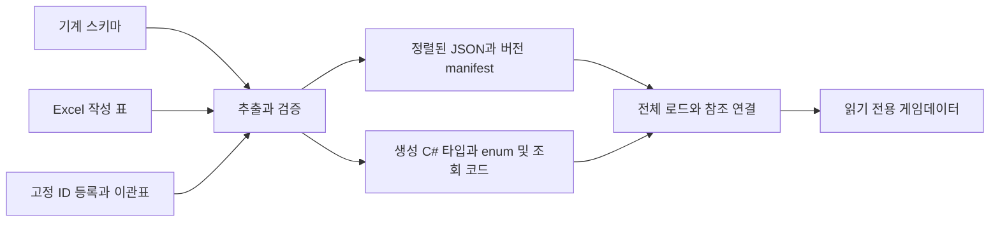

# 게임데이터 작성과 변환 규칙

## 결정과 적용 범위

사용자 직접 요구는 하드코딩 최소화, 재사용성 우선, 데이터 연결 유지, 적은 열·시트, int와 enum 활용이다. 아래 세부는 ‘공개 게임 사례를 보고 규칙을 정의하자’는 위임에 따른 설계 결정이다. 조사 근거와 대안은 [[05 검증과 확장/공개 게임데이터 사례와 적용 판단]]에서 확인한다.

이 문서는 신규·이관 데이터의 작성 및 변환 기준이다. 문자열 키·논리 테이블당 한 시트 제안을 대체한다. 2026-10-13 현재 6시트·정수 ID 이관, 스키마/등록표/검증기/생성기, 훈련소 데이터 로딩을 구현했다. 보존 수치 179개 중 175개는 Pending이며 훈련소 임시 수치 38개를 별도 Provisional로 관리한다. Python 검사 23개, Unity 로더 검사 12개, 전투 회귀 26개가 통과했다. 신화 효과·공명·밸런스와 기존 세이브 ID 이관은 후속이다. 실제 계약과 증거는 [[05 검증과 확장/신화 빌드 Excel 데이터 계약]]를 따른다.

우선순위는 **동작 의미와 참조 보존 → 공통 기능 재사용 → 작성·검토 편의 → 수동 열과 탭 감소**다. 최소화는 중복·파생·미사용 필드를 줄인다는 뜻이다. 다른 단위나 의미를 한 칸에 숨겨 단순해 보이게 만들지 않는다. 현재 무기·빌드 범위의 목표는 6시트이며 전체 게임의 영구 상한은 아니다.

## 1. 데이터가 맡는 것과 코드가 맡는 것

| 데이터가 선택·설정 | 코드가 구현·보장 |
| --- | --- |
| 무기·카드·신성·장인 종류와 호환 관계 | 입력·물리 접촉·행동 채널·사건 처리 순서 |
| 준비·판정·후딜·비용·범위·대상 조건 | 지원 행동과 효과 처리기 |
| 기존 사건·대상·연산의 조합 | 비용 예약·소비의 단일 집행, root 연쇄 제한 |
| 공격·효과·상태·외형 프로필 참조 | 로딩·검증·실패 처리·버전 이관 |

새 콘텐츠는 기존 지원 기능을 조합하면 행 추가만으로 만들 수 있어야 한다. 새로운 행동 의미는 enum 이름만 추가해서 실행하지 않는다. 스키마와 처리기 및 경계 시험을 함께 추가한다. 무기 이름·ID별 분기, 코드에 직접 쓴 피해·시간·조건 ID는 일반 전투 흐름에 넣지 않는다. 타입별 처리기 분기와 알고리즘 자체는 필요한 코드다.

현재 HP·장탄·연격 순번·예약 마나·실행 ID·root ID·남은 쿨타임은 실행 상태다. 콘텐츠 정의에 쓰거나 공유 프로필 값을 실행 중 변경하지 않는다. 데이터 재로딩은 전투 중 부분 교체하지 않고 명시적 안전 시점에 완성된 묶음 단위로 적용한다.

## 2. 원본과 생성물



- 기획 문서: 동작 의미·단위·적용 시점·실패 정책의 원본.
- 기계 스키마: 필드 타입·필수 조건·FK·enum 번호·허용 범위·출력 여부의 원본. 신규 계약은 `Tools/GameData/` 아래 별도 버전으로 구현한다. 기존 검사기를 먼저 덮어쓰지 않는다.
- Excel: 콘텐츠와 밸런스 값의 원본. 구현된 Excel Table 추출 규칙을 사용한다.
- ID 등록부·이관표: 발급·폐기 이력과 기존 키의 대응 원본. 임의 재생성하지 않는다.
- C# DTO·enum·키 상수·등록 목록, JSON, 스키마 설명·enum 선택 목록·검증 보고서는 생성물이다. 생성물을 수동 편집해서 원본과 다른 값을 유지하지 않는다.

기계 스키마와 Excel에 같은 enum·필드 정의를 각각 수동 유지하지 않는다. `공통` 시트의 정의 안내와 드롭다운은 스키마에서 재생성한다. 문서 의미와 스키마 변경은 같은 변경에서 검토한다.

## 3. int ID와 참조

| 항목 | 규칙 |
| --- | --- |
| 콘텐츠 기본 키 | 테이블별 양의 signed Int32, 1~2,147,483,647. 실제로 정수인 숫자 셀만 허용 |
| 0 | 런타임 선택 참조의 None 예약값. 실제 콘텐츠 ID로 발급하지 않음 |
| 발급 | 등록부에서 테이블별 미사용 ID를 예약·기록하고 발급. 이름·행 위치·정렬 결과로 생성하지 않음 |
| 폐기 | ID와 enum 번호 재사용 금지. 저장 호환성이 필요하면 명시적 대체 또는 삭제 정책을 이관표에 기록 |
| 정체성 | `(테이블 종류, id)`가 식별자. Weapon과 Effect가 같은 숫자를 가져도 혼동하지 않음 |
| 참조 | 열 스키마에 대상 테이블 고정. 가능한 C# API는 `WeaponId`, `EffectId` 같은 int 기반 타입을 생성해 혼입 방지 |
| 복합 키 | `AttackStep(pattern_id, step_index)`처럼 소유자 내에서만 의미 있는 행은 복합 키 허용. 모든 연결 행에 새 ID를 강제하지 않음 |
| 저장 | 발급된 영구 ID 저장. 배열 위치·실행 중 생성한 인덱스·문자열 해시 저장 금지 |

`code_name`은 사람이 검색하고 생성 상수 이름을 정하는 문자열이다. 테이블 내 고유한 `lower_snake_case`를 쓰고 예약어·생성 심볼 충돌을 검사한다. 게임은 code_name 비교로 행동을 결정하지 않는다. 실제 문자열은 이름·설명·번역 키·문서 키·리소스 GUID/주소 등 의미가 문자열인 곳에 남긴다.

원본의 `name_key`와 기존 런타임의 `name_term`은 번역 시스템 어댑터로 연결하며 콘텐츠 PK와 분리한다. 리소스도 게임데이터에서는 int `resource_id`로 참조하고 Resource 안의 Addressables 주소·GUID는 문자열로 유지한다. 파일명이나 Sprite 이름을 콘텐츠 ID로 추론하지 않는다.

필수 ID가 비면 미작성이다. 선택 ID의 빈 셀은 ‘연결 없음’으로 변환해 런타임 0을 사용한다. ‘참조를 정하지 못함’은 값 검토 메타데이터에 Pending으로 명시하며 활성 출력에서 차단한다. Excel에서 0을 넣어 미정과 없음을 혼동하지 않는다. 복수 테이블을 가리켜야 하는 제한된 필드는 허용된 `OwnerKind` enum과 owner_id를 함께 사용하고 모든 종류별 대상 참조를 검사한다.

브랜치 간 발급 충돌은 병합 전에 탐지한다. 신규 미출하 행만 새 ID로 재발급하며 해당 변경의 모든 FK와 등록부를 같이 수정한다. 배포된 ID를 정렬하거나 빈 번호를 메우지 않는다. ID 숫자 구간으로 무기 종류·등급·단계를 추론하지 않는다.

## 4. enum의 경계

| enum으로 관리 | int ID 테이블로 관리 |
| --- | --- |
| 코드가 처리하는 ActionKind, TriggerEvent, TargetRule, EffectOperation, ShapeKind, CompareOp, JoinMode | 무기·카드·신격·장인·효과 프로필·태그·리소스의 개별 콘텐츠 |
| 서로 배타적인 처리 방식·출력 상태·검토 상태 | 계속 추가되는 이름·목록·수치·조건 집합 |

WeaponFamily는 콘텐츠 분류 테이블을 유지한다. 가족 이름만 보고 입력이나 모션을 분기하지 않고 행동·모션 프로필을 참조한다. 코드 의미가 같은 상수 분류가 필요할 때만 별도 enum을 추가한다. 모든 무기 이름을 거대한 enum으로 만들지 않는다.

enum 멤버에는 명시적 숫자를 배정하고 순서로 번호를 만들지 않는다. 삭제 번호는 예약하고 기존 의미를 바꿔 재사용하지 않는다. 0=None/Unknown은 해당 필드가 허용할 때만 유효하다. 필수 행동의 Unknown은 오류다. Excel은 생성된 영문 enum 이름 드롭다운으로 편집하고 출력에서는 등록된 int로 변환한다. 자유 문자열·정수·한글 별칭을 행마다 혼용하지 않는다. 한글 설명은 읽기 전용 안내로 보여준다.

Flags는 독립적으로 동시에 켤 수 있는 고정 비트 집합에만 사용한다. 태그 점수·우선순위·단계를 비트로 압축하지 않는다. 초기에는 관계 행이 기본이며 Flags를 도입할 때 허용 비트 마스크까지 검사한다.

## 5. 6개 작업 시트

하나의 작업 시트에 여러 **이름 있는 Excel Table**을 둘 수 있다. 시트는 편집 동선, Table은 행 의미와 검증 단위다. 현재 21시트를 그대로 숨기는 방식은 사용하지 않는다.

| 작업 시트 | 작성 표의 역할 | 가져오는 현재 내용 |
| --- | --- | --- |
| 무기 | 1·2·3차를 보는 WeaponStage, 성장 비용·자격과 지원 연결 | Weapon, Upgrade, ProgressionEdge의 단일 부모 연결, 계보 표시 |
| 전투 | CombatProfile, WeaponAction, AttackPattern/Step/Shape, Reload·Charge·Projectile 등 필요한 프로필 | 기존 AttackPattern과 무기 수치, 후속 전투 명세 |
| 효과 | Effect, 타입별 매개 표, EffectSet 연결, StatusProfile | Effect, UpgradeEffect와 관련 NumericValue |
| 빌드 | Divinity, Card, Artisan, TagGrant, 조건·후보 풀 | Divinity, CardCandidate, 후속 장인·태그·조건 |
| 공통 | Text, Resource, Culture, WeaponFamily 및 생성된 스키마·enum 안내 | Culture, WeaponFamily, Text, ParameterDefinition/StageDefinition/Schema 안내 |
| 검증 | 생성 오류·미정 목록·요약·계보 조회, 값 검토 근거 | Overview, Lineage, Data, Audit, Pending, ReadMe의 필요한 정보 |

`신성·카드`라는 이전 제안명은 장인·태그·조건까지 담는 `빌드`로 구체화한다. 일반 작성자는 처음 4개 작업 시트를 중심으로 수정한다. 검증 시트의 요약·계보는 원본 표의 읽기 전용 보기이고 별도의 콘텐츠 원본이 아니다. 수치 검토 근거만 명시된 작성 영역에서 편집한다.

Table 이름은 통합 문서 내 고유하며 스키마에 등록한다. 열은 영문 snake_case, 단위는 `_sec`, `_ratio`, `_count`, `_units`, `_units_per_sec` 등으로 표시한다. 헤더·ID·게임 입력 영역은 병합하지 않는다. 정렬·필터·행 추가는 Table 단위로 수행한다. 숨김/필터 상태가 출력 대상을 결정하지 않는다.

가변 길이 표를 같은 열 아래에 연속으로 쌓지 않는다. 필요한 표는 같은 헤더 행에서 서로 겹치지 않는 열 블록에 두고 세로 확장 공간을 확보한다. 표 삽입·열 확장이 다른 표를 밀거나 겹치면 실패시킨다. 링크·필터로 원하는 표와 ID에 접근하게 한다. 고정 `2~1001행`이나 첫 빈 줄로 끝을 추론하지 않고 실제 Table 범위를 읽으며 범위 밖 데이터 누락도 검사한다.

한 시트가 지나치게 넓어져 찾기·대조가 어려우면 같은 계약을 유지한 채 전투 같은 영역을 분리할 수 있다. 분리 사유는 실제 탐색·공동 편집 부담이어야 한다. 논리 표가 하나 늘었다는 이유만으로 탭을 추가하지 않는다. 적·맵·퀘스트까지 처음부터 이 6시트에 억지로 넣지 않는다.

## 6. 열을 줄이는 규칙

1. **파생값 제거:** 총 연격 시간·타격 수·DPS·부모 경로는 계산한다. 원본 수치와 계산 결과를 함께 수동 입력하지 않는다.
2. **공통 값 한 곳:** 같은 패턴·충전·재장전·효과·외형은 프로필 ID를 공유한다. 독립 조정이 필요해지면 새 프로필 ID를 발급한다.
3. **다중 값은 행:** 효과1/효과2, 1타/2타, 조건1/조건2 열을 늘리지 않는다. 소유자 ID와 순번이 있는 자식 행을 사용한다.
4. **의미 있는 타입:** 피해·시간·비율을 `param_1`, `value1`에 번갈아 넣지 않는다. 자유 JSON·쉼표 ID 목록·실행 스크립트를 일반 셀에 넣지 않는다.
5. **종류별 필드 분리:** 공통 필드만 기본 표에 두고 차이 큰 종류는 같은 시트의 타입별 표로 나눈다. 모든 종류의 필드를 거대한 한 표에 합치지 않는다.
6. **무의미한 범용화 금지:** 표시용 작은 분류나 1:1 정보까지 모두 새 참조 표로 만들지 않는다. 같은 의미·단위·변경 주기일 때 합치고, 재사용·다중성·타입 차이가 있을 때 분리한다.
7. **검토 메타데이터 분리:** 기획 근거·출처·변환 로그는 실행 데이터에서 제외한다. 행마다 모든 공통 열을 강제로 붙이지 않는다.

열 개수에 고정 상한은 두지 않는다. 신규 열마다 ‘이미 존재하는 값·프로필로 표현할 수 없는가, 단위·읽는 시점·필수 조건은 무엇인가’를 검토한다. 열을 3개로 줄이려고 거대한 key/value 테이블로 바꾸는 것은 작성·검증 비용 감소가 아니다.

## 7. 무기·공격·효과의 연결 예시

아래는 새 작성 구조의 핵심 필드 계약이다. 실제 콘텐츠 번호·밸런스·지원 enum 목록을 확정한 예시 데이터는 아니다. 전체 전투 명세는 [[05 검증과 확장/게임데이터 열 정의]]와 C/D/U/B/R 기준을 재사용한다.

| 표 | 핵심 필드 | 제약·읽는 시점 |
| --- | --- | --- |
| WeaponStage | id, code_name, name_key, parent_id, family_id, combat_profile_id, effect_set_id, row_state | 한 행은 한 성장 단계. 부모는 같은 family, 순환 금지. 장착·성장 때 읽음 |
| CombatProfile | id, normal_action_id, special_action_id, base_attack | 같은 조작·기본 수치를 공유. special 선택 참조는 명시된 무기에서만 허용 |
| AttackStep | pattern_id, step_index, windup_sec, active_sec, recovery_sec, damage_coefficient_ratio, attack_shape_id | 소유자 내 1부터 연속 순번. 실제 시간·피해 스냅샷은 기존 C16/D09 |
| EffectSetEntry | effect_set_id, order_index, effect_id, layer, divinity_id, min_divinity_stage | 기본 layer는 신성 참조 없음. 공명만 신성·단계 검사. 장착 등록과 자격 변경 시 평가 |
| Effect | id, trigger_event, target_rule, operation, condition_set_id, cooldown_sec | 지원 처리기에 연결. 사건 발생 시 조건과 재사용 대기 검사 |
| DamageEffect | effect_id, damage_coefficient_ratio, damage_profile_id | 해당 operation에서만 필수인 1:1 매개 표. 다른 operation의 값 입력 금지 |

WeaponStage의 `parent_id`는 성장 연결이다. 값 상속이나 이전 단계 효과 누적을 뜻하지 않는다. 현재 단일 부모 계보의 stage는 부모 깊이에서 계산하고 기존 Upgrade.stage_index와 이관 대조한다. 자식은 필요한 combat_profile과 effect_set을 명시적으로 연결한다. 부모를 바꿔도 빈 셀이 자동으로 부모 값을 얻지 않는다. 다중 부모를 도입할 때는 별도 ProgressionEdge 표와 DAG 계약으로 확장하고 구분자 문자열로 우회하지 않는다.

성장 비용·장인 지원·조건처럼 단계별로 필요한 추가 관계는 `무기`/`빌드` 시트의 명시적 표로 둔다. 신성을 무기 기본 행에 붙여 모든 기본 기능의 필수 조건으로 만들지 않는다. 기본/공명 분리와 `replace_parent_base` 의미를 보존한다. 앞선 무기 검토에서 제기된 기본 보상의 모호함은 데이터 타입 변경만으로 해결되거나 채택된 것이 아니다.

조건은 기존 ConditionSet → ConditionGroup → ConditionTerm과 AND/OR 의미를 유지한다. 효과 그래프의 임의 스크립트 실행은 허용하지 않는다. 낙인·회수·영역·재진입처럼 상태를 유지하는 기능은 검증 가능한 상태 프로필과 지원 사건으로 분해한다. 표식 수명, 영역 수명, 보상 대기시간을 하나의 duration으로 공유하지 않는다. 효과를 쪼개더라도 원래 출처·실행 ID·root·사건 순서를 유지해야 한다.

같은 수치라고 동일 프로필로 자동 합치지 않는다. 의미와 변경 의도까지 같아야 공유한다. 공유 프로필 수정 전 역참조 목록을 보여주고 영향받는 모든 무기·카드 검증을 수행한다. 표 정렬은 게임 실행 순서가 아니며 order_index와 기존 사건 정렬 정책을 사용한다.

## 8. 값·빈 셀·작성 상태

| 항목 | 규칙 |
| --- | --- |
| 일반 숫자 | 숫자 셀. 단위 문자열·공백·천 단위 문자열을 넣지 않음. NaN·Infinity·정수 범위 초과 거부 |
| 단위 | 초·월드 단위·배율로 통일. ratio의 1=100%, 확률은 0~1. 월드 축척은 현재 미정 상태를 보존 |
| bool | 실제 TRUE/FALSE. 숫자 0/1이나 Y/N과 혼용하지 않음 |
| 필수 숫자 빈 값 | Pending. 0이나 스키마 기본값으로 자동 보충하지 않음 |
| 선택 필드 빈 값 | 스키마에 정의된 ‘없음/해당 없음’만 의미. 미정을 숨기지 않음 |
| enum 빈 값 | 필수면 오류. 선택이면 스키마가 명시한 None만 허용 |
| 수식 | 게임 입력 셀에는 금지. 조회·요약·검증용 읽기 전용 영역에만 허용 |

row_state는 Draft/Test/Release/Retired를 구분하는 명시적 enum으로 생성한다. 새 콘텐츠 기본은 Draft이며 기존 enabled와 중복 관리하지 않는다. 수치 상태 Pending/Provisional/Fixed는 행의 출력 상태와 다른 개념이다. 기존 179개 값의 상태·근거를 이관 메타데이터로 보존하고 신규 값의 검토 기록도 ID·필드로 연결한다. 셀 주소·색상만으로 상태를 기록하지 않는다.

값 검토 기록은 작성 메타데이터다. 일반 수치를 계속 NumericValue 형태로 출력하지 않는다. 실제 값은 소유 타입의 열에 두고 기록은 `(논리 표, 영구 ID 또는 복합 키, 필드)`로 따라간다. 메타데이터의 필드 이름·문서 위치 문자열은 게임의 콘텐츠 참조 키와 구분한다.

- 작성 검사: ID·타입·참조 오류는 Draft도 오류. 명시된 미정 숫자·미구현 기능은 미완료 보고서로 남긴다.
- Test 출력: 선택한 시험 루트와 의존 관계 전체에 필수값·지원 처리기가 있어야 하며 각 소유 정의는 Test 또는 Release 상태여야 한다. Provisional을 허용하며 시험 데이터임을 manifest에 남긴다. 별도 상태가 없는 자식 행은 소유 정의의 상태를 따르고 공유 프로필은 자체 상태를 가진다.
- Release 출력: Release 루트의 의존 관계 전체가 Release여야 한다. 필요한 수치 검토 완료, 미지원 기능·Pending 없음, 자원 참조 검사를 요구한다. 이는 밸런스의 영구 고정을 뜻하지 않는다.
- Retired 행은 새 참조·출력 금지다. 검증 실패를 조용히 행 제외·0 대입·다른 무기로 대체하지 않는다.

엑셀 수식으로 만든 시험 수치를 쓰고 싶으면 근거를 기록한 값으로 명시적으로 반영한다. 저장된 수식 캐시만 신뢰해 런타임 값을 생성하지 않는다. 데이터 빌드에서는 Excel 실행·매크로·외부 통합문서 연결이 필요 없어야 한다.

## 9. 코드 생성과 실행

스키마에서 DTO, enum, int 기반 참조 타입, 키 상수, 테이블 등록 목록, 참조·범위 검증, 역참조 보고서를 생성한다. code_name은 디버깅 및 생성 상수용이며 일반 콘텐츠 선택은 설정이나 보상·장착 데이터가 넘긴 ID를 따른다.

```csharp
// 목표 API 설명. 아직 생성되거나 구현된 코드는 아니다.
var stage = tables.WeaponStages.Get(loadout.WeaponStageId);
var combat = tables.CombatProfiles.Get(stage.CombatProfileId);
var action = tables.Actions.Get(combat.SpecialActionId);
actionHandlers.Get(action.Kind).Request(actor, action);
```

특정 기본 무기를 고정해야 하는 진입점은 생성된 `WeaponStageIds` 상수 또는 시작 설정의 FK를 사용한다. `if (id == 1001)`이나 이름 비교로 공격을 구현하지 않는다. 행동·효과 enum마다 지원 handler가 등록됐는지 빌드에서 검사한다. enum 값의 숫자 크기로 category를 추론하는 현행 Item 검사는 후속 이관 때 명시적 관계 검사로 교체한다.

초기 출력은 **UTF-8 JSON + 생성 C# + manifest**다. JSON은 안정된 키 순서와 ID/명시 순번 정렬을 사용한다. 로드 시 모든 테이블을 먼저 읽고 참조를 연결·검증한 뒤 한 번에 공개한다. 로딩 실패 시 부분 갱신하지 않는다. 자주 쓰는 관계는 로드 후 타입이 있는 참조로 해석하고 매 프레임 문자열을 파싱하지 않는다.

manifest에는 schema_version, data_revision, generator_version, 원본·스키마·ID 등록부 해시, 출력 대상과 출력 해시를 남긴다. 내용 해시에서 생성 시각 같은 비결정적 메타데이터는 제외한다. 클라이언트가 지원하지 않는 스키마 버전은 로드 실패다. 바이너리는 실제 로딩·메모리 측정에서 필요할 때 같은 논리 계약의 출력 옵션으로 추가한다.

## 10. 검증과 변경 관리

| 단계 | 검사 |
| --- | --- |
| 추출 | 등록된 Table 존재·중복 없음, 헤더 일치, 겹침 없음, 표 밖 입력·미등록 열 감지 |
| 값 | 타입·정수 범위·단위·enum·필수 조건·수치 상태, 입력 수식 금지 |
| 참조 | FK 존재·테이블 타입, 비활성/폐기 참조, 모든 의존 관계의 출력 가능 여부 |
| 구조 | 성장 순환·도달 가능성·단계·family 일치, 순번 중복·누락, 조건 빈 그룹, 효과 종류별 필수 매개 |
| 의미 | 기본/공명 분리, 자가 신성 자격 금지, 비용·공속·출처·상한은 기존 기준 유지 |
| 생성 | 동일 원본의 출력 동일성, 생성 코드 컴파일, 미지원 처리기·리소스·누락 번역 키 |
| 반영 | 일부 파일 실패 시 전체 배포 중단, 버전 불일치 거부, 안전 시점 일괄 교체 |

오류는 파일·시트·Table·콘텐츠 ID·필드·원인·기대값으로 보고한다. 셀 위치는 보조 정보다. 잘못된 ID 한 개, 미정 값 한 개, enum 미지원 한 개를 경고로 넘겨 활성 출력하지 않는다. 검증 보고서는 현재 원본 해시를 표시해 옛 오류 0 결과를 재사용하지 않게 한다.

XLSX 원본과 스키마·발급/이관 기록은 Git에서 관리한다. 생성 JSON을 안정적으로 정렬해 리뷰에서 값·참조 변경을 비교한다. XLSX 충돌은 양쪽 변경을 표·ID 기준으로 대조하고 재검증한다. 임의로 한쪽 파일을 고르거나 자동 ID 재정렬로 해결하지 않는다. 재생성 후 차이가 남으면 생성물 불일치로 처리한다.

## 11. 현행 데이터 이관 순서

1. data-0.1 원본의 Git revision·파일 해시·기존 검사 결과를 고정한다. 기존 파일을 기준으로 새 규칙의 예시 수치를 만들어 채우지 않는다.
2. `(기존 테이블, string ID) → (새 테이블, int ID)` 대응표를 먼저 발급한다. Weapon 7개와 Upgrade 28개가 WeaponStage로 합쳐질 때 총 35개가 충돌 없이 대응돼야 한다. 서로 다른 기존 테이블의 같은 문자열도 구분한다.
3. 6시트 작성 표를 만들고 행과 모든 참조를 옮긴다. 28개 성장 연결, 46개 기본/공명 프로필과 연결, 14개 카드 후보, 텍스트·출처를 대조한다. 원자 효과 분해로 개수가 바뀌면 기존 프로필에서 여러 새 행으로의 추적표를 남긴다.
4. NumericValue를 의미별 타입 필드로 옮긴다. 175개 Pending과 4개 Fixed 0 및 전체 179개의 근거를 보존한다. 모호한 보상·새로운 행동을 숫자 이관 과정에서 임의 확정하지 않는다.
5. 생성기·검증기·DTO·로더를 새 버전으로 연결한다. 현재 CommonInstant·Item·Hero의 string/int 혼합 계약은 별도 호환 이관을 거친다. 저장·해금·프리팹·번역·리소스 참조 사용처를 검색하고 대응시킨다.
6. 대표 무기 한 경로의 Test 출력과 훈련장 검증을 수행한다. 구조가 맞는 것과 무기 기능·조작감이 맞는 것을 따로 기록한다. 모든 데이터가 0 오류라도 플레이 검증을 완료 처리하지 않는다.
7. 신구 의미 대조와 아래 검증을 통과한 뒤 새 원본을 활성 계약으로 전환한다. 롤백은 원본·스키마·생성물·manifest를 같은 revision으로 되돌린다.

현재 데이터는 아직 실행 데이터가 아니므로 이관 전 지원 코드와 수치가 없는 것은 예상된 후속이다. 6시트로 배치하는 것만으로 런타임 준비 완료가 되지는 않는다.

## 12. 완료 조건과 검증 계획

아래는 새 도구·이관 후 수행할 시험이며 이번 규칙 문서 작성으로 통과 처리하지 않는다.

| ID | 완료 조건 | 상태 |
| --- | --- | --- |
| DATA-V01 | 정렬·행 삽입·표 이동·표시 이름 변경 후 ID/FK와 출력 의미 동일 | 미실시 |
| DATA-V02 | 중복/음수/범위 밖 ID·다른 테이블 ID·없는 FK·폐기 ID 재사용 거부 | 미실시 |
| DATA-V03 | enum 표시 순서 변경에도 번호 동일, 미지원 값·필수 None 거부 | 미실시 |
| DATA-V04 | Pending·실제 0·선택 없음·Provisional 구분, Test/Release 의존 관계 검사 | 미실시 |
| DATA-V05 | 같은 프로필 공유·독립 복제의 영향 목록 정확, 기존 기능 조합은 코드 수정 없이 추가 | 미실시 |
| DATA-V06 | 성장 순환·family 불일치·순번 누락·빈 조건·잘못된 공명 연결 거부 | 미실시 |
| DATA-V07 | Table 범위 확장·1001행 이후·표 겹침·범위 밖 데이터·입력 수식 감지 | 미실시 |
| DATA-V08 | 같은 원본에서 같은 출력, 실패 시 부분 공개 없음, 스키마 버전 불일치 거부 | 미실시 |
| DATA-V09 | 35개 계보·기존 효과/카드·179개 수치와 미정·근거의 이관 추적 보존 | 미실시 |
| DATA-V10 | 대표 무기의 생성 데이터 로드와 기본/특수/공명 동작, 기존 전투 회귀 확인 | 미실시 |

## 연결

[[00 MOC/게임데이터 MOC]] · [[05 검증과 확장/게임데이터 열 정의]] · [[05 검증과 확장/게임데이터 관계와 추가 절차]] · [[05 검증과 확장/Excel과 기획 문서의 연결]] · [[05 검증과 확장/프로토타입 범위와 검증]]

## data-1.0 구현 경계 — 2026-10-13

2026-10-13 현재 6시트·정수 ID 이관, 스키마/등록표/검증기/생성기, 훈련소 데이터 로딩을 구현했다. 보존 수치 179개 중 175개는 Pending이며 훈련소 임시 수치 38개를 별도 Provisional로 관리한다. Python 검사 23개, Unity 로더 검사 12개, 전투 회귀 26개가 통과했다. 신화 효과·공명·밸런스와 기존 세이브 ID 이관은 후속이다. 실제 계약과 증거는 [[05 검증과 확장/신화 빌드 Excel 데이터 계약]]를 따른다.

위 범용 규칙의 CombatProfile/원자 Effect/ConditionSet 등은 목표 구조다. 현재 실행 구현은 TrainingLoadout과 이동·마나·연격·충전 프로필에 한정된다. 신화 효과는 EffectDesign과 typed facet으로 의미를 보존한다. 전체 DATA-V 완료와 구분한다.